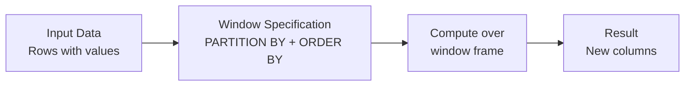

# Advanced Transformations

## Overview

Advanced transformation techniques enable complex data processing beyond standard SQL operations. User-defined functions (UDFs), window functions, and collection operations provide flexibility for sophisticated data pipelines.

> [!abstract]
>
> - Collection functions: `explode`, `split`, `array_contains`, `transform`, `filter`, `flatten`
> - Window functions (`ROW_NUMBER`, `RANK`, `LAG`) for ranking, deduplication, and running totals
> - Prefer built-in functions to Python UDFs. UDFs are opaque to the optimizer and add serialization cost

> [!tip] What the Exam Tests
>
> - Exam guide skill: manipulate columns and rows: split strings, explode arrays, rename, filter
> - Exam guide skill: Bronze → Silver cleaning, including null handling and type standardization
> - Choosing a higher-order function (`filter`, `transform`) over `explode` + `groupBy`

---

## User-Defined Functions (UDFs)

### Python UDFs

```python
from pyspark.sql.functions import udf
from pyspark.sql.types import StringType, IntegerType

# Simple Python UDF

def categorize_salary(salary):
    if salary is None:
        return None
    if salary < 50000:
        return "Entry"
    elif salary < 100000:
        return "Mid"
    else:
        return "Senior"

# Register UDF

categorize_udf = udf(categorize_salary, StringType())

# Use in DataFrame

df_categorized = (employees
    .withColumn("level", categorize_udf(col("salary")))
)
```

### Pandas UDFs (Vectorized)

Pandas UDFs **often** outperform regular row-at-a-time Python UDFs: Apache Arrow transfers columnar batches between Spark/JVM and Python, and each call processes a Pandas Series. Vectorization and lower per-row overhead help, but speedups depend on the workload. Prefer Spark built-in expressions when possible:

```python
from pyspark.sql.functions import pandas_udf
import pandas as pd

@pandas_udf("string")
def categorize_salary_pandas(salary_series: pd.Series) -> pd.Series:
    """Vectorized UDF - processes entire batch at once"""
    result = pd.Series(pd.NA, index=salary_series.index, dtype="string")
    result.loc[salary_series < 50000] = "Entry"
    result.loc[(salary_series >= 50000) & (salary_series < 100000)] = "Mid"
    result.loc[salary_series >= 100000] = "Senior"
    return result

df_categorized = (employees
    .withColumn("level", categorize_salary_pandas(col("salary")))
)
```

### SQL UDFs

```python
# Register as SQL function

spark.udf.register("categorize_salary_sql", categorize_salary, StringType())

# Use in SQL

result = spark.sql("""
    SELECT
        id,
        name,
        salary,
        categorize_salary_sql(salary) as level
    FROM employees
""")
```

### Scala UDFs

```python
spark.udf.registerJavaFunction(
    "my_java_udf",
    "com.example.MyFunctions.processData",
    StringType()
)
```

## Window Functions



### Window Function Syntax

```sql
SELECT
    name,
    department,
    salary,
    -- Ranking functions
    ROW_NUMBER() OVER (PARTITION BY department ORDER BY salary DESC) as row_num,
    RANK() OVER (PARTITION BY department ORDER BY salary DESC) as rank,
    DENSE_RANK() OVER (PARTITION BY department ORDER BY salary DESC) as dense_rank,

    -- Aggregate functions over window
    AVG(salary) OVER (PARTITION BY department) as dept_avg,
    SUM(salary) OVER (PARTITION BY department) as dept_total,

    -- Lead/Lag
    LAG(salary) OVER (ORDER BY hire_date) as prev_salary,
    LEAD(salary) OVER (ORDER BY hire_date) as next_salary
FROM employees
```

### Window Functions in Python

```python
from pyspark.sql.window import Window
from pyspark.sql.functions import row_number, rank, dense_rank, lag, lead, avg

# Define window

window_dept = Window.partitionBy("department").orderBy(F.desc("salary"))

df_windowed = (employees
    .withColumn("row_num", row_number().over(window_dept))
    .withColumn("rank", rank().over(window_dept))
    .withColumn("dense_rank", dense_rank().over(window_dept))
    .withColumn("dept_avg", avg("salary").over(Window.partitionBy("department")))
)
```

### Common Window Functions

| Function | Purpose | Example |
|----------|---------|---------|
| `ROW_NUMBER()` | Unique row number in window | `1, 2, 3, ...` |
| `RANK()` | Rank with gaps | `1, 1, 3, ...` |
| `DENSE_RANK()` | Rank without gaps | `1, 1, 2, ...` |
| `LAG()` | Previous row value | Get prior salary |
| `LEAD()` | Next row value | Get next salary |
| `FIRST_VALUE()` | First value in window | First salary in partition |
| `LAST_VALUE()` | Last value in window | Last salary in partition |
| `NTH_VALUE()` | Nth value in window | 3rd highest salary |

## Collection Functions

### Arrays

```python
from pyspark.sql.functions import array, concat, array_contains

# Create arrays

df_array = employees.select(
    col("name"),
    array(col("first_name"), col("last_name")).alias("name_parts")
)

# Array operations

df_array = employees.select(
    col("skills"),
    array_contains(col("skills"), "Python").alias("knows_python"),
    F.size(col("skills")).alias("num_skills")
)

# Explode array into rows

df_exploded = (employees
    .selectExpr("name", "explode(skills) as skill")
)

# Collect array from GROUP BY

df_collected = (employees
    .groupBy("department")
    .agg(F.collect_list("name").alias("employees"))
)
```

### Maps

A Map has key/value pairs. All map values must use a **compatible type**. `lit("salary")` is the constant key `"salary"`; `col("salary")` reads each row's salary. Because salary is numeric and department is a string, convert salary to a string in this example:

```python
from pyspark.sql import functions as F

df_map = employees.select(
    "name",
    F.create_map(
        F.lit("salary"), F.col("salary").cast("string"),
        F.lit("department"), F.col("department")
    ).alias("info")
)

# Work with df_map: employees itself does not contain an "info" column.
df_accessed = (df_map
    .withColumn("dept", F.col("info")["department"])
    .withColumn("sal", F.col("info")["salary"])
)
df_exploded = df_map.selectExpr("name", "explode(info) AS (key, value)")
df_keys = df_map.select(F.map_keys("info").alias("keys"))
df_values = df_map.select(F.map_values("info").alias("values"))
```

For `Alice, salary=85000, department=IT`, `info` is `{"salary":"85000","department":"IT"}`. Map indexing `info["department"]` returns `IT`; `explode(info)` returns two rows (`salary,85000` and `department,IT`). Iteration order is not guaranteed. For fixed heterogeneous fields (numeric salary + string department), a **Struct** is generally preferable.

### Structs

```python
from pyspark.sql.functions import struct, col

# Create struct

df_struct = employees.select(
    col("name"),
    struct(
        col("name").alias("full_name"),
        col("salary").alias("annual_salary"),
        col("department").alias("dept")
    ).alias("employee_info")
)

# Access struct fields

df_accessed = (df_struct
    .withColumn("emp_name", col("employee_info.full_name"))
    .withColumn("emp_sal", col("employee_info.annual_salary"))
)
```

## String Operations

```python
from pyspark.sql.functions import lower, upper, trim, substring, concat, length

df_strings = employees.select(
    col("name"),
    lower(col("name")).alias("name_lower"),
    upper(col("department")).alias("dept_upper"),
    trim(col("email")).alias("email_clean"),
    substring(col("name"), 1, 3).alias("name_prefix"),
    concat(col("first_name"), lit(" "), col("last_name")).alias("full_name"),
    length(col("name")).alias("name_length")
)
```

## Date and Timestamp Operations

```python
from pyspark.sql.functions import col, current_date, year, month, day, datediff, date_add, from_unixtime
from datetime import datetime, timedelta

df_dates = employees.select(
    col("hire_date"),
    year(col("hire_date")).alias("hire_year"),
    month(col("hire_date")).alias("hire_month"),
    day(col("hire_date")).alias("hire_day"),
    datediff(current_date(), col("hire_date")).alias("days_employed"),
    date_add(col("hire_date"), 365).alias("one_year_anniversary"),
    from_unixtime(col("timestamp_ms") / 1000).alias("readable_timestamp")
)
```

## Conditional Logic

```python
from pyspark.sql.functions import when, coalesce, col, lit

# Simple when/otherwise

df_conditional = (employees
    .withColumn("bonus_eligible",
        when(col("salary") > 100000, True).otherwise(False)
    )
)

# Multiple conditions

df_bonus = (employees
    .withColumn("bonus_pct",
        when(col("salary") >= 150000, 0.20)
        .when(col("salary") >= 100000, 0.15)
        .when(col("salary") >= 50000, 0.10)
        .otherwise(0.05)
    )
)

# Coalesce (first non-null value)

df_coalesce = (employees
    .withColumn("contact",
        coalesce(col("email"), col("phone"), lit("No contact"))
    )
)
```

## Flattening nested structures

**Array of Structs example:** `addresses` has type `ARRAY<STRUCT<street: STRING,city: STRING>>`. If Alice has two addresses, `explode(addresses)` creates two Alice rows, each with a single address Struct; the next `select` extracts `address.street` and `address.city`.

| name | address.street | address.city |
|---|---|---|
| Alice | King St | Toronto |
| Alice | Queen St | Kingston |

`explode` skips empty and null arrays; use `explode_outer` to preserve the row with a null result.

```python
# Unnest array column

df_unnested = (employees
    .select("id", "name", F.explode("addresses").alias("address"))
    .select("id", "name", "address.street", "address.city")
)

# Flatten struct

df_flattened = (employees
    .select(
        "id",
        "name",
        col("contact_info.email").alias("email"),
        col("contact_info.phone").alias("phone")
    )
)
```

## Pivot Operations

### Pivot to Columns

`PIVOT` turns distinct row values into columns, then aggregates the corresponding values. For example, 2024 Engineering salaries `80000` and `90000` become `eng = 170000` on the 2024 row.

```sql
-- Project only year, department and salary first.
-- Otherwise columns such as employee id/name become implicit grouping keys.
SELECT *
FROM (SELECT year, department, salary FROM employees)
PIVOT (
    SUM(salary)
    FOR department IN ('Engineering' AS eng, 'Sales' AS sales, 'HR' AS hr)
);
```

```python
df_pivoted = (employees
    .groupBy("year")  # output rows
    .pivot("department", ["Engineering", "Sales", "HR"])  # output columns
    .agg(F.sum("salary"))  # value per year and department
)
```

Without `PIVOT`, familiar SQL conditional aggregation gives the same layout:

```sql
SELECT year,
    SUM(CASE WHEN department = 'Engineering' THEN salary END) AS eng,
    SUM(CASE WHEN department = 'Sales' THEN salary END) AS sales,
    SUM(CASE WHEN department = 'HR' THEN salary END) AS hr
FROM employees
GROUP BY year;
```

`AS eng` is a column **alias**. Omitting `ELSE 0` preserves NULL for a year with no matching department, as in the PIVOT example.

## Null Handling

`NULL` = missing/unknown; `NaN` = special floating-point Not a Number. `isnull(NULL)` is true but `isnan(NULL)` is false. `isnull(NaN)` is false but `isnan(NaN)` is true.

| Need | T-SQL / Synapse | Spark SQL | PySpark |
|---|---|---|---|
| Check NULL | `salary IS NULL` | `salary IS NULL` | `F.isnull("salary")` |
| Replace NULL | `ISNULL(salary, 0)` | `COALESCE(salary, 0)` | `df.fillna({"salary": 0})` |

Unlike PySpark `isnull`, T-SQL's `ISNULL(value, replacement)` **replaces** NULL. `fillna` also replaces floating-point NaN; it does not clean empty strings automatically.

```python
from pyspark.sql.functions import isnan, isnull, col   # fillna/dropna are DataFrame methods

# Check for nulls

df_nulls = employees.select(
    col("name"),
    isnull(col("email")).alias("email_missing"),
    isnan(col("salary")).alias("salary_invalid")
)

# Drop nulls

df_clean = employees.dropna(subset=["email"])

# Fill nulls with value

df_filled = (employees
    .fillna({
        "email": "unknown@company.com",
        "department": "Unassigned"
    })
)

# Fill nulls with forward fill

# Forward fill ordered salaries: [80000, NULL, NULL, 95000, NULL]
# → [80000, 80000, 80000, 95000, 95000]
# Add partitionBy("employee_id") for employee-specific histories.
# Include a tie-breaker if hire_date values repeat.
window_fill = Window.orderBy(col("hire_date"), col("id"))
df_forward_filled = employees.withColumn(
    "salary",
    F.last(col("salary"), ignoringNulls=True).over(
        window_fill.rowsBetween(Window.unboundedPreceding, 0)
    )
)
```

### Parse JSON strings with `from_json`

`from_json` parses a **JSON string column** into a typed Struct, Array or Map using the supplied schema. It differs from `spark.read.json(path)`, which reads a JSON data source.

```python
# json_data = '{"name":"Alice","age":30}'
df_parsed = df.withColumn(
    "parsed",
    F.from_json("json_data", "name STRING, age INT")
)
df_flat = df_parsed.select("parsed.name", "parsed.age")
# Reverse: F.to_json("parsed")
```

In permissive parsing, malformed JSON typically results in a null result; missing fields become null.

## Performance Considerations

### Broadcast vs Shuffle

```python
# Broadcast for small reference tables

from pyspark.sql.functions import broadcast

result = large_df.join(
    broadcast(small_reference),
    large_df.key == small_reference.key
)

# Shuffle for large-to-large joins

result = df1.join(df2, df1.key == df2.key)
```

### Caching Strategy

```python
# Cache frequently used DataFrames

df_cleaned = df.filter(col("sales") > 100)
df_cleaned.cache()  # lazy: marks a result for caching
df_cleaned.count()  # first action: execute and populate distributed cache

# Use it multiple times

result1 = df_cleaned.select("name", "sales")
result2 = df_cleaned.filter(col("sales") > 500)
result1.show()  # actions reuse the cached intermediate result
result2.show()

# Remove from cache

df_cleaned.unpersist()  # releases cached blocks; does NOT delete source data
```

Cached data is distributed on Executors (memory/disk), unlike `collect()` which transfers all rows to the Driver. Cache is temporary, not a persistent Delta checkpoint. Cache only costly intermediate results reused by multiple actions.

## UDF vs Built-in Functions

| Aspect | Built-in | UDF |
|--------|----------|-----|
| **Performance** | Fast (optimized) | Slower |
| **Flexibility** | Limited | Unlimited |
| **Optimization** | Catalyst optimizes | Limited optimization |
| **When to Use** | Always prefer | Last resort |

## Use Cases

- **Flattening Nested JSON Payloads**: Using `explode()`, `from_json()`, and struct access patterns to transform deeply nested API responses or event logs into flat, queryable Delta tables.
- **Custom Business Logic via UDFs**: Applying Python or Pandas UDFs for domain-specific transformations (e.g., address parsing, custom scoring functions) that cannot be expressed with built-in Spark functions.

## Common Issues & Errors

### Python UDF Slows a Silver Job

**Scenario:** A Python UDF that lowercases and trims strings makes a Silver job several times slower.
**Fix:** Use built-in functions (`lower`, `trim`, `regexp_replace`). The optimizer can't see inside Python UDFs, and every row is serialized to Python. If a UDF is unavoidable, use a vectorized pandas UDF.

### UDF Serialization Errors

**Scenario:** A Python UDF fails with `PicklingError` or `SerializationException` because it references a non-serializable object (e.g., a database connection or logger).
**Fix:** Use Pandas UDFs (vectorized) or built-in Spark functions instead. If a custom UDF is necessary, ensure all referenced objects are serializable or instantiate them inside the UDF function body.

### Schema Mismatch When Exploding Nested Data

**Scenario:** `explode()` on a JSON-derived column fails with `AnalysisException` because the inferred schema for `ArrayType` or `MapType` is inconsistent across rows.
**Fix:** Use `from_json()` with an explicit schema definition before exploding, ensuring all rows conform to the same expected structure.

## Exam Tips

- Always prefer built-in Spark functions over UDFs; UDFs bypass Catalyst optimization and are slower
- Pandas UDFs use Arrow batches and Pandas Series and are often faster than regular UDFs; performance is workload-dependent. Built-in Spark expressions are generally the preferred starting point
- Know the difference between `ROW_NUMBER()`, `RANK()`, and `DENSE_RANK()` -- especially how they handle ties
- `explode()` converts an array column into multiple rows; this is a common exam question pattern

## Key Takeaways

- **UDF**: User-defined functions for custom logic; Pandas UDFs faster than Python UDFs
- **Window Functions**: Compute values over partitions without aggregating rows
- **Collections**: Arrays, maps, structs for complex data types
- **String/Date**: Standard functions for text and temporal data
- **Conditionals**: when/otherwise for complex business logic
- **Null Handling**: Use fillna/dropna for data quality
- **Optimization**: Use broadcast for small tables, avoid UDFs when possible
- **Pivot**: Transform data from rows to columns

## Related Topics

- [My Notes: Advanced Transformations FAQ](../../../my-notes/03-advanced-transformations.md)
- [Joins and Aggregations](./03-joins-aggregations.md)
- [PySpark API Quick Reference](../../../shared/cheat-sheets/pyspark-api-quick-ref.md)
- [Python Patterns (Code Examples)](../../../shared/code-examples/python/python_patterns.md)

## Official Documentation

- [PySpark Built-in Functions](https://docs.databricks.com/en/pyspark/index.html)
- [Window Functions](https://docs.databricks.com/en/sql/language-manual/sql-ref-functions-builtin.html#window-functions)

---

**[← Previous: Joins and Aggregations](./03-joins-aggregations.md) | [↑ Back to Data Transformation and Modeling](./README.md) | [Next: Data Cleaning and Data Quality →](./05-data-cleaning-and-quality.md)**
