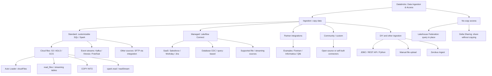
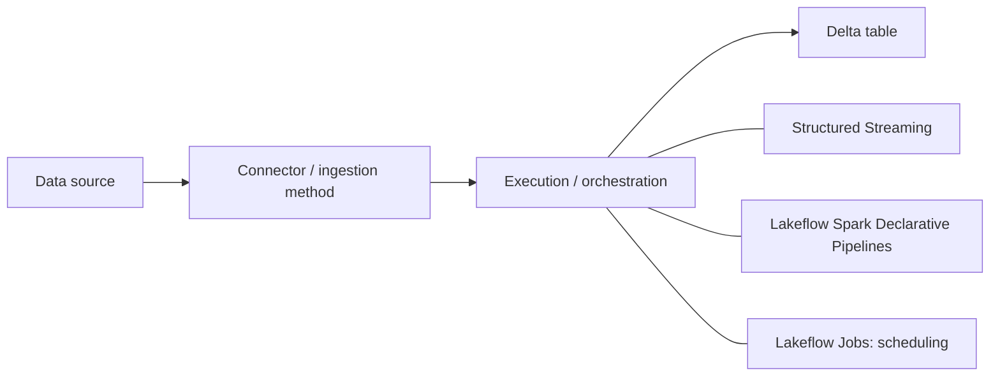

# Domain 2 — Data Ingestion and Loading

Sources: [Domain 2 materials](../certifications/data-engineer-associate/02-data-ingestion-and-loading/README.md).

## Ingestion decision guide
| Requirement | Usually choose | Watch for |
|---|---|---|
| Ingest arriving cloud files | Auto Loader / Lakeflow pipeline | Schema location, checkpoint, new-file discovery |
| Copy small/occasional cloud file batches | COPY INTO | Idempotency and file tracking |
| Supported SaaS/database | Lakeflow Connect | Availability and connector-specific CDC |
| Custom relational pull | JDBC | Parallel reads are not automatically CDC |
| External REST/SFTP | API / transfer code to files or DataFrame | Auto Loader cannot directly poll REST or SFTP |
| Query source without copying | Lakehouse Federation | No materialized local ingestion |

**Distinction:** Ingestion extracts data; a *job* orchestrates it; Structured Streaming executes ongoing or triggered processing; a Delta table is a possible destination. A watermark is not necessarily complete CDC (especially deletes).

## Connector and method hierarchy

> Study reference for Databricks Certified Data Engineer Associate. These categories overlap: a source such as Kafka may have both custom and managed integration options. Connector availability varies by cloud, region, and release.

## 1. Ingestion and no-copy access



## 2. How ingestion is executed



**Example:** ADLS → Auto Loader → Lakeflow pipeline → Bronze streaming table.

## 3. Important distinctions

| Concept | Meaning | Example |
| --- | --- | --- |
| Source | Where data originates | ADLS, Kafka, SQL Server |
| Standard ingestion | Customizable code-based integration | Auto Loader, COPY INTO, Kafka Structured Streaming |
| Managed connector | Databricks-maintained integration for supported sources | Lakeflow Connect for supported SaaS / databases |
| Partner connector | Integration supplied by a third party | Fivetran |
| Processing framework | How ingestion/transformation executes | Structured Streaming, Lakeflow pipelines |
| Orchestration | When and in what order tasks run | Lakeflow Jobs |
| Execution pattern | Whether processing is full batch, incremental batch, or continuous streaming | availableNow vs processingTime |

- **Auto Loader** is a specific cloud-file ingestion mechanism, not a competing top-level connector category. It can run in Structured Streaming or declarative pipelines.
- **Kafka** is a data source, not an execution mode; integration options depend on the available connectors.
- **CDC** is a change-capture approach, not a top-level connector type.
- **SFTP** generally requires a suitable external integration or custom transfer step; do not assume Auto Loader reads SFTP directly.
- **Lakehouse Federation** queries external data in place; **Delta Sharing** enables data sharing without requiring a conventional ingestion pipeline.
- **availableNow=True** processes available data and terminates; **processingTime** keeps a streaming query running.

## Official Databricks references

- [Ingestion overview](https://docs.databricks.com/aws/en/ingestion/overview)
- [Lakeflow Connect](https://docs.databricks.com/aws/en/ingestion/lakeflow-connect)
- [Auto Loader](https://docs.databricks.com/aws/en/ingestion/cloud-object-storage/auto-loader/)
- [Structured Streaming](https://docs.databricks.com/aws/en/structured-streaming/)
- [Lakehouse Federation](https://docs.databricks.com/aws/en/query-federation/)

---

## Examples, pitfalls and personal Q&A

> Exam-focused explanations and examples from our study discussion. This note complements the ingestion course notes and [Glossary](./Glossary.md).

## 1. What is schema inference?

**Schema inference** discovers the initial column names and data types from input files. Auto Loader samples up to **50 GB or 1,000 files** by default (whichever threshold is reached first) and persists its inferred schema in `cloudFiles.schemaLocation`.

For JSON, CSV, and XML, Auto Loader normally infers columns as **STRING** to avoid unexpected type mismatches; `cloudFiles.inferColumnTypes=true` asks it to infer specific types. Parquet and Avro have embedded type information.

Example input: `{"id":101,"active":true}`

- Default JSON Auto Loader inference: `id STRING, active STRING`
- With `inferColumnTypes=true`: typically `id BIGINT, active BOOLEAN`

**Inference** determines the initial schema; **evolution** handles later schema changes.

## 2. How do Auto Loader schema evolution modes differ?

Initial columns: `id, name`. A new file contains `id, name, age`.

| Mode | New `age` field | Stream behavior |
| --- | --- | --- |
| `addNewColumns` | Added to the tracked schema | Raises `UnknownFieldException`; restart to use updated schema |
| `addNewColumnsWithTypeWidening` | Adds columns and supports eligible type widening | Restart required; check runtime/feature support |
| `rescue` | Stored in `_rescued_data`, not added to schema | Continues without schema-change failure |
| `failOnNewColumns` | Not added | Fails until the unexpected column is addressed |
| `none` | Ignored by default, or rescued if configured | Continues |

`addNewColumns` is generally the default when no explicit schema is provided; `none` is generally the default with a supplied schema. **Source schema evolution is distinct from target Delta table schema evolution.**

```python
df = (spark.readStream
    .format("cloudFiles")
    .option("cloudFiles.format", "json")
    .option("cloudFiles.schemaLocation", "/Volumes/main/raw/_schemas/orders")
    .option("cloudFiles.schemaEvolutionMode", "rescue")
    .load("/Volumes/main/raw/orders"))
```

## 3. How does Auto Loader discover files? What is a queue service?

| Discovery approach | How it works | Trade-off |
| --- | --- | --- |
| Directory listing | Lists the input path to discover files | Simple setup; listing can become costly at scale |
| Classic file notifications | Cloud storage emits events into notification/queue infrastructure | Requires cloud resource permissions and setup |
| Managed file events | Unity Catalog external location enables Databricks-managed file event discovery | Preferred for supported workloads; reduces setup burden |

**Azure example:** ADLS BlobCreated event → Event Grid → Azure Queue Storage → Auto Loader consumes the notification → reads the file → Bronze table.

A **queue** stores event messages (such as a file path), **not** the file contents. It **does not by itself launch a Databricks Job**. An already running stream can consume events, or a separately scheduled/triggered job can start and ingest available files. Job orchestration and file discovery are separate concerns.

## 4. Why is Auto Loader used for API, JDBC, and SFTP scenarios?

Auto Loader is a **cloud-file ingestion engine**, not a universal API/database connector.

```text
REST API / JDBC database / SFTP
          |
   Python / JDBC / ADF / transfer tool
          |
     ADLS / S3 / GCS files
          |
       Auto Loader
          |
     Bronze Delta table
```

Auto Loader can ingest files **originating from** APIs or databases **after** another process lands those files in cloud storage. It does not directly call REST endpoints or perform JDBC queries. Direct REST → DataFrame → Delta and JDBC → DataFrame → Delta are also valid; managed connectors can be simpler for supported sources.

## 5. What are JDBC and REST?

- **JDBC (Java Database Connectivity):** standard database-access API. A JDBC driver uses a database-specific wire protocol (e.g., PostgreSQL protocol or SQL Server TDS).
- **REST (Representational State Transfer):** an API architectural style, typically implemented over HTTP/HTTPS; REST endpoints often return JSON.
- Neither JDBC nor REST is itself the low-level network protocol.

Example JDBC URL: `jdbc:postgresql://db.example.com:5432/sales`

Example HTTP exchange:

```http
GET /api/orders/101 HTTP/1.1
Host: api.example.com
Accept: application/json

HTTP/1.1 200 OK
Content-Type: application/json

{"order_id":101,"status":"completed"}
```

## 6. What do the Spark JDBC options mean?

```python
jdbc_url = "jdbc:postgresql://db.example.com:5432/sales"
orders = (spark.read
    .format("jdbc")
    .option("url", jdbc_url)
    .option("dbtable", "public.orders")
    .option("user", dbutils.secrets.get(scope="jdbc", key="username"))
    .option("password", dbutils.secrets.get(scope="jdbc", key="password"))
    .option("partitionColumn", "order_id")
    .option("lowerBound", "1")
    .option("upperBound", "10000000")
    .option("numPartitions", "8")
    .option("fetchSize", "1000")
    .load())
orders.write.mode("overwrite").saveAsTable("main.bronze.orders_snapshot")
```

| Option | Meaning |
| --- | --- |
| `format("jdbc")` | Select JDBC data source |
| `url` | JDBC connection string: database type, host, port, database |
| `dbtable` | Source table (e.g. `public.orders`) **or aliased subquery** |
| `user`, `password` | Credentials; retrieve from secrets rather than hard-coding |
| `partitionColumn` | Numeric/date/timestamp column used to split parallel reads |
| `lowerBound`, `upperBound` | Determine **partition stride**, **not row filtering** |
| `numPartitions` | Upper limit on JDBC partitions / concurrent connections |
| `fetchSize` | Number of rows fetched per JDBC round trip (driver-dependent); **not** a SQL LIMIT |
| `mode("overwrite")` | Replaces the target table data: **full snapshot**, not incremental CDC |
| `saveAsTable` | Writes DataFrame to a named table |

`dbtable` example with filtering:

```python
.option("dbtable", "(SELECT * FROM public.orders WHERE status = 'active') AS t")
```

Do **not** set both `dbtable` and `query`. For JDBC partitioned reads involving a subquery, use an aliased `dbtable` expression.

## 7. What is dbutils?

**Databricks Utilities** supplies platform helpers; Spark performs distributed data processing.

| API | Example purpose |
| --- | --- |
| `dbutils.secrets.get("jdbc", "password")` | Read secret value from a secret scope |
| `dbutils.fs.ls("/Volumes/main/raw/orders/")` | List files |
| `dbutils.widgets.text("run_date", "2026-11-06")` | Declare notebook parameter |
| `dbutils.widgets.get("run_date")` | Read notebook parameter |
| `dbutils.notebook.run(...)` | Invoke another notebook |

## 8. What is CDC, and how is it different from a watermark?

**CDC (Change Data Capture)** captures source **INSERT / UPDATE / DELETE** changes, often using database transaction logs. Managed database connectors may use CDC to maintain a downstream replica.

| | Watermark-based incremental extraction | CDC |
| --- | --- | --- |
| Inserts | Usually | Yes |
| Updates | If reliably timestamped/tracked | Yes |
| Deletes | Often not detected | Yes, when supported/configured |
| Typical method | `updated_at > last_watermark` | Database log changes |

**Lakehouse Federation** queries data in place without maintaining a copied table; a custom JDBC notebook can implement incremental extraction but does not automatically provide CDC.

## 9. What does explode() do with nested JSON?

A JSON object becomes a Spark **struct** and a JSON list becomes an **array** when read with a typed schema. Use dot paths for struct fields and `explode()` for array elements.

Input:

```json
{"order_id":101,"customer":{"id":"C01","address":{"city":"Toronto"}},"line_items":[{"sku":"A001","qty":2},{"sku":"B002","qty":3}]}
```

```python
from pyspark.sql.functions import col, explode
flat = (raw
    .select(
        col("order_id"),
        col("customer.id").alias("customer_id"),
        col("customer.address.city").alias("city"),
        explode(col("line_items")).alias("item"))
    .select("order_id", "customer_id", "city",
            col("item.sku").alias("sku"),
            col("item.qty").alias("qty")))
```

Output:

| order_id | customer_id | city | sku | qty |
| --- | --- | --- | --- | --- |
| 101 | C01 | Toronto | A001 | 2 |
| 101 | C01 | Toronto | B002 | 3 |

**`explode()`:** one array element → one output row. NULL/empty arrays produce **zero** rows. **`explode_outer()`:** preserves a row with a NULL expanded value for NULL/empty arrays.

## Exam reminders

- **Auto Loader** = discover and ingest new **cloud files**, not directly invoke REST/JDBC.
- **Queue** = file arrival messages; **Lakeflow Jobs** = scheduling/orchestration.
- **Schema inference** = initial structure; **schema evolution** = later changes.
- **JDBC bounds** = partition stride, not filters; **fetchSize** ≠ LIMIT.
- **CDC** = inserts, updates, deletes; **watermark** may miss deletes.
- **explode** = array to rows; **explode_outer** retains NULL/empty arrays.

## Official references

- [Auto Loader schema inference and evolution](https://docs.databricks.com/aws/en/ingestion/cloud-object-storage/auto-loader/schema)
- [Auto Loader options](https://docs.databricks.com/aws/en/ingestion/cloud-object-storage/auto-loader/options)
- [Auto Loader file notification mode](https://docs.databricks.com/aws/en/ingestion/cloud-object-storage/auto-loader/file-notification-mode)
- [Spark JDBC data source](https://spark.apache.org/docs/latest/sql-data-sources-jdbc.html)
- [Databricks Utilities](https://docs.databricks.com/aws/en/dev-tools/databricks-utils)
- [PySpark explode](https://spark.apache.org/docs/latest/api/python/reference/pyspark.sql/api/pyspark.sql.functions.explode.html)

## Mock Exam 1 — Concept Clarifications (not missed questions; Q5/Q8/Q9/Q12/Q24)

### Auto Loader vs Job triggers vs compute

- **Auto Loader** = incremental cloud-file discovery/ingestion, via `spark.readStream.format("cloudFiles")`.
- **Scheduled trigger** = run a job at a specified time; possible empty runs.
- **File arrival trigger** = start a job when qualifying files arrive in a monitored location; often avoids empty scheduled runs.
- **Continuous job trigger** = keep the job running for near-continuous processing; not a synonym for Auto Loader.
- **`availableNow=True`** = Structured Streaming processes currently available input and then terminates; useful inside a triggered job.
- **Serverless Jobs compute** = resources on which the task runs, not an ingestion method.

Example flow: *files arrive in a UC Volume → file arrival trigger starts a Lakeflow Job → a notebook on serverless Jobs compute uses Auto Loader → checkpoint identifies unprocessed input → Bronze Delta table.*

Important Auto Loader options:

| Option | Meaning |
|---|---|
| `format("cloudFiles")` | Enable Auto Loader |
| `cloudFiles.format` | Underlying files: json/csv/parquet/etc. |
| `cloudFiles.schemaLocation` | Store inferred schema and evolution metadata |
| `checkpointLocation` (writer) | Track streaming progress/state for recovery |
| `cloudFiles.schemaEvolutionMode` | Choose `addNewColumns`, `rescue`, `failOnNewColumns`, `none` |
| `cloudFiles.maxFilesPerTrigger` | Cap number of files in each micro-batch |
| `cloudFiles.maxBytesPerTrigger` | Approximate data-volume cap per batch |
| `cloudFiles.useManagedFileEvents` | Use managed file-event discovery when configured/supported |

```python
source = "/Volumes/main/raw/landing/orders"
schema_dir = "/Volumes/main/ops/state/orders-schema"
checkpoint = "/Volumes/main/ops/state/orders-checkpoint"
(
    spark.readStream.format("cloudFiles")
    .option("cloudFiles.format", "json")
    .option("cloudFiles.schemaLocation", schema_dir)
    .option("cloudFiles.schemaEvolutionMode", "rescue")
    .option("cloudFiles.maxFilesPerTrigger", 100)
    .load(source)
    .writeStream
    .option("checkpointLocation", checkpoint)
    .trigger(availableNow=True)
    .toTable("main.bronze.orders")
)
```
Here `rescue` keeps unexpected fields in `_rescued_data`; it does **not** process row-level CDC. Schema evolution and data-change propagation are different questions.

### JDBC partitioning for parallel PostgreSQL reads

```python
orders = (spark.read.format("jdbc")
    .option("url", jdbc_url)
    .option("dbtable", "public.orders")
    .option("user", username)
    .option("password", password)
    .option("partitionColumn", "order_id")
    .option("lowerBound", "1")
    .option("upperBound", "1000000")
    .option("numPartitions", "4")
    .load())
```

- **`partitionColumn`** = source field used to split JDBC reads (supported numeric/date/timestamp types).
- **`lowerBound` / `upperBound`** = partition stride calculation bounds, **not a WHERE filter for the full dataset**.
- **`numPartitions`** = parallel JDBC partitions / approximate maximum parallel connections.
- `.repartition(4)` **after** `.load()` cannot parallelize the preceding single JDBC read.
- JDBC source partitions ≠ Spark shuffle partitions.

### Delta streaming UPDATE/DELETE vs schema evolution (Q9)

A default append-only Delta **streaming source read** can fail when upstream Delta transactions rewrite/update/delete existing records.

- If downstream **does not need** updates: `spark.readStream.option("skipChangeCommits", "true").table("main.bronze.customers")`; changed commits are skipped, not replayed as new values.
- If downstream **must apply** updates/deletes: use **Change Data Feed (CDF)** / CDC-aware processing, or an `AUTO CDC` flow into a target streaming table with keys and sequencing.
- **Schema evolution** (`rescue`, `addNewColumns`) concerns changing **columns/fields**; **CDC** concerns updating **existing rows**.
- A target streaming table is *not categorically immutable*: managed CDC processing can maintain current-state data (SCD Type 1).

### JSON STRING vs STRUCT/ARRAY (Q12 clarification)

For a column `raw STRING` containing `{"line_items":[{"sku":"A1"},{"sku":"B7"}]}`:

```sql
SELECT raw:line_items[0].sku FROM bronze_orders;  -- JSON path: first SKU
```

If parsed as `STRUCT<line_items: ARRAY<STRUCT<sku: STRING>>>`, use a struct field expression such as `parsed.line_items[0].sku`. **Colon for JSON path on a JSON string; dot for an actual STRUCT field.** Array indices start at zero. `STRUCT`, `ARRAY` and `MAP` are Apache Spark SQL complex types, not Databricks-only types.

**Mock Exam 1 classification:** Q12 was a *missed question*; the other items in this section were *questions raised during review*, not additional mistakes.
