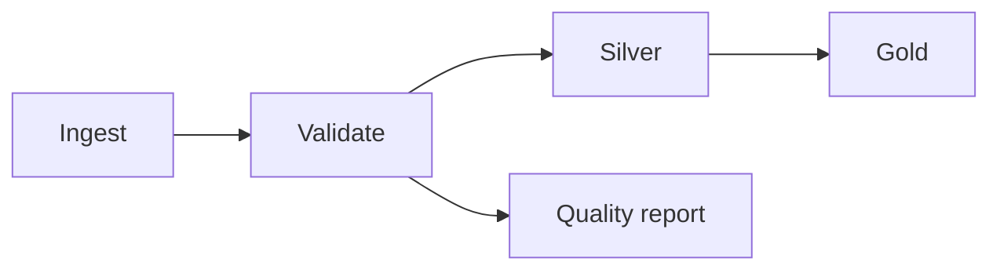

# Domain 4 — Working with Lakeflow Jobs

Sources: [Jobs and tasks](../certifications/data-engineer-associate/04-working-with-lakeflow-jobs/01-lakeflow-jobs-and-tasks.md), [Scheduling and triggers](../certifications/data-engineer-associate/04-working-with-lakeflow-jobs/02-scheduling-triggers.md), [Control flow](../certifications/data-engineer-associate/04-working-with-lakeflow-jobs/03-control-flow.md).

## 1. Job, task, run and DAG
- **Lakeflow Jobs** is the *orchestrator*: defines task DAG (**Directed Acyclic Graph**), triggers, parameters, compute, retries and notifications.
- **Job** = configuration; **run** = an execution instance; **task** = a node; **Depends on** = dependency edge. Independent tasks may execute concurrently.
- Common task types: Notebook, Python script/wheel, SQL query/alert/dashboard, pipeline, dbt, Run Job, If/else, For each and JAR.
- A task that must run *after* `ingest` should have `Depends on: ingest`, not the reverse.
- **Task compute**: serverless where supported, jobs compute for production isolation, existing all-purpose compute when appropriate; don't confuse compute choice with scheduling.



## 2. Triggers and scheduling
| Trigger | When to use | Important distinction |
|---|---|---|
| Scheduled | Known clock time | Quartz cron plus explicit time zone; watch DST |
| File arrival | New files in monitored external location / volume | Job trigger is separate from Auto Loader file discovery |
| Table update | Upstream UC table/view changes | Can wait for any/all monitored objects |
| Continuous | Run continuously | Starts subsequent runs after completion; not combined with other triggers |
| Manual | Ad hoc or testing | Can override run parameters |

- **max_concurrent_runs** limits *simultaneous job runs*, not the number of tasks in a DAG.
- **Task concurrency** (e.g. For each concurrency) is a separate setting.
- Cron syntax for Quartz includes seconds: `second minute hour day-of-month month day-of-week` (with supported optional year); `?` means no specified day-of-month/day-of-week value.
- Use timeout, retries, pause/resume, alert configuration and time zone deliberately.

## 3. Task values and parameters
- **Job parameters** configure the run; tasks can reference them. Dynamic value references (e.g. `{{job.run_id}}`) are resolved for a specific run.
- **Task values** carry small outputs from one upstream task to a downstream task. This is metadata/control flow, *not a bulk DataFrame transfer*.

```python
# In task named ingest
dbutils.jobs.taskValues.set(key="rows_loaded", value=120)

# In a downstream task depending on ingest
n = dbutils.jobs.taskValues.get(taskKey="ingest", key="rows_loaded")
if n > 0:
    print("Continue processing")
```

**Exam trap:** reading a task value from an unrelated/non-upstream task can fail; add the correct `Depends on`. Also distinguish numerical comparison from lexicographic string comparison in If/else tasks.

## 4. Control flow: If/else, For each, Run if
- **If/else**: evaluate a condition against literals, parameters or task values, then route to true/false downstream dependencies.
- **For each**: one nested task repeats over an input array; default iteration concurrency is 1, configurable (e.g. concurrency 5 to process 40 tables).
- **Run if** options: All succeeded (default), At least one succeeded, None failed, All done, At least one failed, All failed.
- **Retries** handle transient failures (flaky API); retry interval and per-attempt timeout matter. **All done** is useful for cleanup even after failures; **At least one failed** for incident escalation.
- **Run Job** invokes an existing job to compose modular workflows.

### Exam-style scenarios
1. Zero records ingested? `If/else` on `rows_loaded` to skip Silver and Gold.
2. Forty tables with the same extraction logic? `For each` over table names, set suitable concurrency.
3. Unreliable REST source? Configure retries on the extraction task, not necessarily the entire job.
4. Cleanup must happen after success *or* failure? `Run if: All done`.
5. Failure ticket? `Run if: At least one failed`.
6. Cleanup task skipped after failure? Inspect dependencies and `Run if`, rather than only changing timeout.

## 5. UI and monitoring checklist
- Workspace → **Workflows / Jobs & Pipelines** → select job → Tasks graph/DAG → Runs → task details.
- Compare **Jobs matrix / run timeline** to identify failed/slow tasks; drill into task logs and Spark UI / query profile as supported by compute.
- Ensure notifications have correctly configured destinations; merely having a failing task does not imply alert delivery.

## Common English exam terms
`flaky` = intermittently unreliable; `dependency` = prerequisite task; `trigger` = run-start condition; `retry interval` = pause between attempts; `timeout` = limit per attempt; `upstream/downstream` = predecessor/successor in DAG; `excluded` = skipped by branching; `concurrency` = simultaneous executions.
