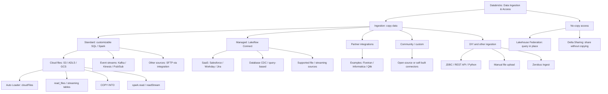
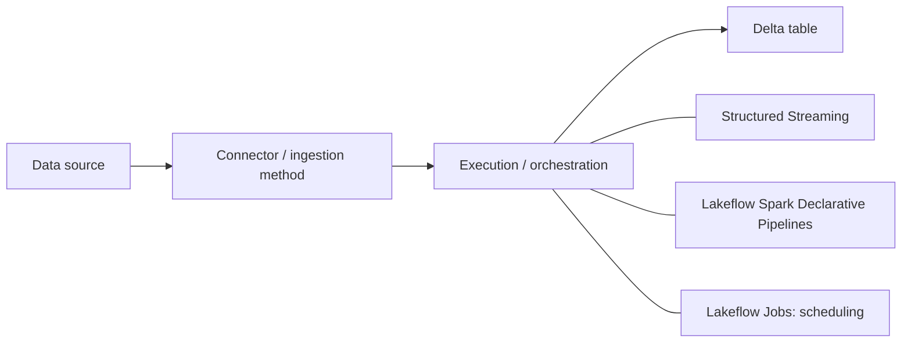

# Databricks Data Ingestion — Connector & Method Hierarchy

> Study reference for Databricks Certified Data Engineer Associate. These categories overlap: a source such as Kafka may have both custom and managed integration options. Connector availability varies by cloud, region, and release.

## 1. Ingestion and no-copy access

## 2. How ingestion is executed

**Example:** ADLS → Auto Loader → Lakeflow pipeline → Bronze streaming table.

## 3. Important distinctions

| Concept | Meaning | Example |
| --- | --- | --- |
| Source | Where data originates | ADLS, Kafka, SQL Server |
| Standard ingestion | Customizable code-based integration | Auto Loader, COPY INTO, Kafka Structured Streaming |
| Managed connector | Databricks-maintained integration for supported sources | Lakeflow Connect for supported SaaS / databases |
| Partner connector | Integration supplied by a third party | Fivetran |
| Processing framework | How ingestion/transformation executes | Structured Streaming, Lakeflow pipelines |
| Orchestration | When and in what order tasks run | Lakeflow Jobs |
| Execution pattern | Whether processing is full batch, incremental batch, or continuous streaming | availableNow vs processingTime |

- **Auto Loader** is a specific cloud-file ingestion mechanism, not a competing top-level connector category. It can run in Structured Streaming or declarative pipelines.
- **Kafka** is a data source, not an execution mode; integration options depend on the available connectors.
- **CDC** is a change-capture approach, not a top-level connector type.
- **SFTP** generally requires a suitable external integration or custom transfer step; do not assume Auto Loader reads SFTP directly.
- **Lakehouse Federation** queries external data in place; **Delta Sharing** enables data sharing without requiring a conventional ingestion pipeline.
- **availableNow=True** processes available data and terminates; **processingTime** keeps a streaming query running.

## Official Databricks references

- [Ingestion overview](https://docs.databricks.com/aws/en/ingestion/overview)
- [Lakeflow Connect](https://docs.databricks.com/aws/en/ingestion/lakeflow-connect)
- [Auto Loader](https://docs.databricks.com/aws/en/ingestion/cloud-object-storage/auto-loader/)
- [Structured Streaming](https://docs.databricks.com/aws/en/structured-streaming/)
- [Lakehouse Federation](https://docs.databricks.com/aws/en/query-federation/)
